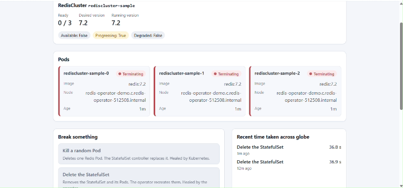
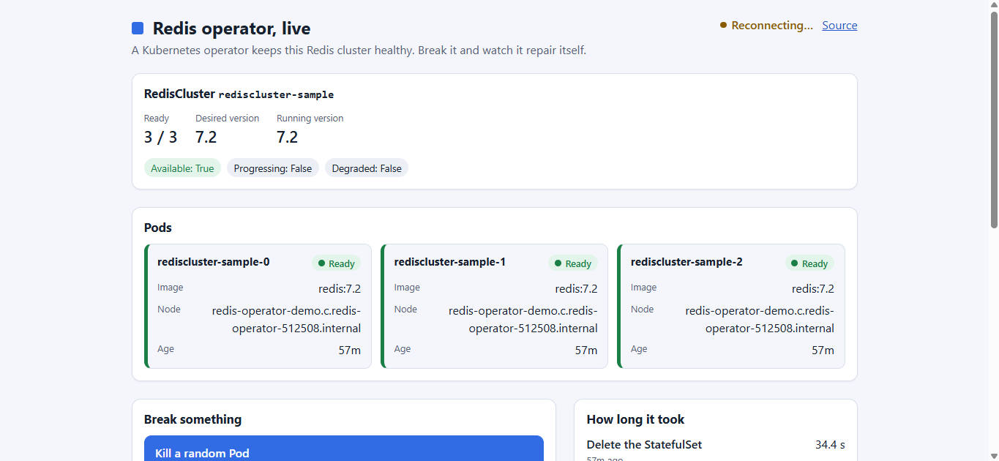
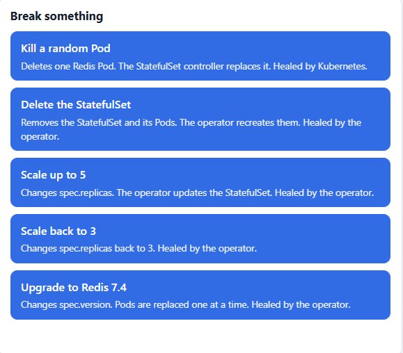
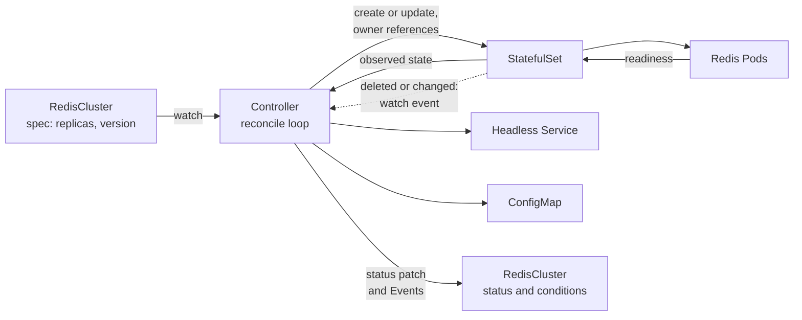

# redis-operator

[](https://github.com/Muditjain13/redis-operator/actions/workflows/test.yml)
[](https://github.com/Muditjain13/redis-operator/actions/workflows/lint.yml)
[](https://github.com/Muditjain13/redis-operator/actions/workflows/web.yml)
[](https://github.com/Muditjain13/redis-operator/actions/workflows/test-e2e.yml)

[](https://goreportcard.com/report/github.com/Muditjain13/redis-operator)
[](https://codecov.io/gh/Muditjain13/redis-operator)
[](docs/DESIGN_NOTES.md#12-ci-badges-and-measurements)

[](docs/DESIGN_NOTES.md#12-ci-badges-and-measurements)
[](docs/DESIGN_NOTES.md#12-ci-badges-and-measurements)
[](docs/DESIGN_NOTES.md#12-ci-badges-and-measurements)
[](docs/DESIGN_NOTES.md#12-ci-badges-and-measurements)

[](go.mod)
[](LICENSE)
[](https://redisoperator.dpdns.org)

**A Kubernetes operator, software that runs a Redis cluster for you from one short YAML file and repairs it when something breaks, plus a live demo where you can break it yourself.**

## Live demo

**[redisoperator.dpdns.org](https://redisoperator.dpdns.org)**

Press one of five buttons to break the running cluster (kill a Pod, delete the StatefulSet, scale up, scale back, upgrade Redis), watch the operator and Kubernetes repair it, and read the measured recovery time. The page resets itself every 10 minutes, and each visitor can run one action every 30 seconds.

<!-- Screenshots and the GIF go here. Once the files exist, delete this opening comment
     line and the closing comment line so the images show.



-->

## How it works

You declare what you want in a `RedisCluster`. The controller compares it with what exists and fixes any difference, and it does that again every time anything changes, so a deleted or broken piece comes back without anyone running a command.



The step-by-step reconcile flow is in [`docs/DESIGN_NOTES.md`](docs/DESIGN_NOTES.md#7-how-reconcile-works).

## Engineering highlights

These are the values CI last measured and published to the badges above, which are the live source. Nobody types them in: a script refuses to write a badge from a missing or guessed measurement ([how](docs/DESIGN_NOTES.md#12-ci-badges-and-measurements)).

| What | Last measured | What it means |
|---|---|---|
| Operator reaction | 0.2 s | After the StatefulSet is deleted, the time until the operator has recreated it. Includes the polling overhead of the test, so the true figure is lower. |
| Full recovery | 35.7 s (3 pods) | From the delete until all three new Pods are Ready. Longer than the reaction because Redis Pods start one at a time and must pass their readiness probes. |
| Rolling upgrade | 3 of 3 pods | Redis 7.2 to 7.4, with the ready count sampled every second to confirm no more than one Pod is ever down at a time. |
| Envtest suite | 30 specs passing | Run against a real API server and etcd. |
| Statement coverage | about 94.5% (controller package) | The last figure recorded in the design notes. The Codecov badge shows the live total for the whole repository. |
| Go Report Card | A+ | Graded in CI on every push to `main`. |
| Kubernetes | v1.37.0 | The version the end-to-end tests run against. |

What sits behind those numbers:

- **Level-based reconciliation.** The controller works from the desired state, not from events, using `CreateOrUpdate`, owner references and a finalizer, and writes status only when it changed.
- **Three layers of tests.** An envtest suite for every branch and failure injection, end-to-end tests on a real kind cluster (create, delete and recover, rolling upgrade), and unit tests for the portal's backend and its React UI.
- **A rolling upgrade that cannot silently go wrong.** The upgrade is delegated to the StatefulSet controller, and the end-to-end test fails if the ready count ever drops below `replicas - 1`.
- **Observable by design.** Status conditions (`Available`, `Progressing`, `Degraded`) and Kubernetes Events for created, healed, scaled, upgrading and upgraded.
- **Supply chain hygiene in CI.** GitHub Actions pinned by commit SHA, no default token permissions, and exact-pinned web dependencies installed from a lockfile with `npm ci`.

## Security

The demo lets strangers on the internet delete things in a Kubernetes cluster, so it is built to limit what they can reach. In plain terms:

- **Least-privilege RBAC.** The portal runs as its own ServiceAccount with a namespaced Role, never a ClusterRole, that allows only what the buttons need: read and patch one RedisCluster, list, watch and delete its Pods, delete its StatefulSet, and watch events. No secrets, no `exec`, nothing outside the `demo` namespace. The reset job has an even smaller one. See [`deploy/portal/rbac.yaml`](deploy/portal/rbac.yaml); a test fails if the rules widen.
- **Network policy.** In the hosted setup, only the `cloudflared` Pod may open a connection to the portal ([`networkpolicy.yaml`](deploy/hosting/portal/networkpolicy.yaml)). That is what makes it safe to trust the visitor address Cloudflare supplies. Checked live: Pods in other namespaces are refused, and a forged address header is rejected at Cloudflare's edge ([evidence](docs/hosting.md#why-the-network-policy-matters)).
- **Rate limiting and abuse controls.** One action per visitor every 30 seconds, counted per real client address (IPv6 per /64, so rotating through a prefix does not help). Every state-changing request needs a header a browser will not add to a cross-site form, there is no free-text input anywhere, and the page is served with a strict Content-Security-Policy.
- **Hardened containers.** Non-root, read-only filesystem, all capabilities dropped, no privilege escalation, resource limits.
- **No inbound ports and no secrets in git.** The VM exposes only SSH; traffic arrives through an outbound Cloudflare Tunnel. The tunnel's credentials live in a Kubernetes Secret created by hand. The Cloudflare origin certificate, which can manage the whole DNS zone, is kept off the cluster and was deleted from the VM once the tunnel existed.
- **A written dependency policy.** Web dependencies must be stable releases at least 28 days old, pinned to exact versions with a committed lockfile, and installed with `npm ci` in CI, which lowers the chance of picking up a freshly published bad release. The reasoning is in [`DESIGN_NOTES.md`, section 17](docs/DESIGN_NOTES.md#17-web-ui-dependency-policy).

More detail: [portal security model](docs/DESIGN_NOTES.md#19-platform-portal).

## Quick start

You need Docker, [kind](https://kind.sigs.k8s.io/), `kubectl` and Go, or just a browser (below).

```sh
# Everything on a local kind cluster
make kind-deploy      # cluster, operator image, the operator, and a sample RedisCluster
make portal-deploy    # portal image, the portal, and the demo RedisCluster in the "demo" namespace
kubectl -n demo port-forward svc/redis-portal 8080:80     # then open http://localhost:8080

# Or on a cluster you already have (your current kubectl context)
make install deploy IMG=<registry>/redis-operator:tag
```

Run the checks with `make test` (envtest suite), `make lint` and `make test-e2e` (needs a dedicated kind cluster). The command-line version of the demo is `make demo`.

**No local setup:** open it in GitHub Codespaces. The devcontainer installs Go, Node, Docker, kind, kubectl and kubebuilder at pinned, checksum-verified versions. Choose a 4-core machine, because kind runs a whole cluster inside it.

[](https://codespaces.new/Muditjain13/redis-operator)

## Tech stack

| Layer | Technology |
|---|---|
| Operator | Go 1.26, Kubebuilder v4 layout, controller-runtime v0.25, client-go v0.37 |
| API | `RedisCluster` custom resource, `cache.mudit.dev/v1alpha1` |
| Portal backend | Go, client-go, Server-Sent Events, embedded UI in a single distroless image |
| Portal frontend | React 19, TypeScript, Vite, Vitest and Testing Library |
| Tests | Ginkgo and Gomega with envtest, end-to-end on kind, Codecov |
| Delivery | Kustomize, Argo CD (Applications for kind and for the hosted VM) |
| Hosting | k3s on one small VM, Cloudflare Tunnel (`cloudflared`) |
| CI | GitHub Actions, Go Report Card, measured badges on an orphan `badges` branch |

## Architecture

This README stays short on purpose. The deeper reading:

- [`docs/DESIGN_NOTES.md`](docs/DESIGN_NOTES.md): the architecture and reconcile flow ([section 5](docs/DESIGN_NOTES.md#5-architecture)), design decisions and failure modes, the testing strategy, CI and measurements, the portal ([section 19](docs/DESIGN_NOTES.md#19-platform-portal)) and GitOps with Argo CD ([section 20](docs/DESIGN_NOTES.md#20-gitops-with-argo-cd)).
- [`docs/hosting.md`](docs/hosting.md): how the live demo is hosted on one VM with k3s and a Cloudflare Tunnel, as it was actually run.
- [`docs/argocd.md`](docs/argocd.md): deploying with Argo CD, including read access to a private repository.

## Roadmap

What is genuinely not done yet:

- **Argo CD on the hosted VM.** The Applications are written and were run on a local kind cluster, but the live demo was deployed with `kubectl apply`. Running Argo CD on the VM is the next step.
- **Images are built locally, not on the VM.** They are built on a developer machine and streamed into k3s, with no registry and an unchanging `hosted` tag, so a code change means a rebuild and a rollout restart. Versioned published images, or building on the VM, would remove that.

The operator itself is deliberately a demo-scale operator: Redis replicas are independent servers (no replication) and Redis has no authentication or TLS. The full list of known limits is in [`DESIGN_NOTES.md`, section 15](docs/DESIGN_NOTES.md#15-known-limitations-and-future-work).

## License

Apache 2.0, see [LICENSE](LICENSE).
