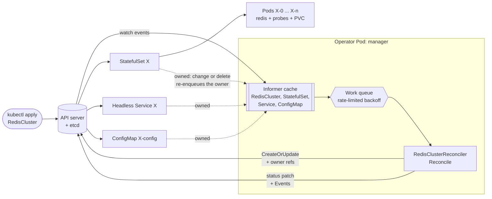
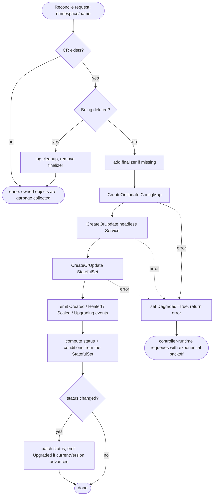

# redis-operator: design notes

Source material for the README. It is written so someone with no memory of how the project was built can write a complete README from this file alone. Facts are taken from the code as committed. Anything numeric that appears on a badge is **measured by CI**; numbers quoted here are observations from local runs and exist only to give the right order of magnitude. Never copy them into the README as claims. Link the badges instead.

Contents

1. [What this project is](#1-what-this-project-is)
2. [Stack and versions](#2-stack-and-versions)
3. [Repository map](#3-repository-map)
4. [What an operator is (README-ready)](#4-what-an-operator-is-readme-ready)
5. [Architecture](#5-architecture)
6. [API reference](#6-api-reference)
7. [How reconcile works](#7-how-reconcile-works)
8. [Design decisions and trade-offs](#8-design-decisions-and-trade-offs)
9. [Failure modes](#9-failure-modes)
10. [Production readiness](#10-production-readiness)
11. [Testing strategy](#11-testing-strategy)
12. [CI, badges and measurements](#12-ci-badges-and-measurements)
13. [Local development, quickstart and demo](#13-local-development-quickstart-and-demo)
14. [Key points from each build phase](#14-key-points-from-each-build-phase)
15. [Known limitations and future work](#15-known-limitations-and-future-work)
16. [Interview talking points](#16-interview-talking-points)
17. [README checklist](#17-readme-checklist)
18. [Web UI dependency policy](#18-web-ui-dependency-policy)

---

## 1. What this project is

A Kubernetes operator, written in Go, that manages Redis instances through a custom resource called `RedisCluster`. It was built as a portfolio project for a Kubernetes platform team (control plane, self-healing infrastructure), so the emphasis is on correct controller behaviour, explainability and tests rather than on Redis features.

- Module: `github.com/Muditjain13/redis-operator`
- API group / version / kind: `cache.mudit.dev` / `v1alpha1` / `RedisCluster` (namespaced)
- Runs locally on kind (Kubernetes in Docker). No cloud resources are used or needed.
- License: Apache 2.0.

What a user gets from one small manifest:

```yaml
apiVersion: cache.mudit.dev/v1alpha1
kind: RedisCluster
metadata:
  name: rediscluster-sample
spec:
  replicas: 3
  version: "7.2"
  resources:
    requests: {cpu: 100m, memory: 128Mi}
    limits:   {cpu: 250m, memory: 256Mi}
  storage:
    size: 1Gi
```

The operator creates and continuously maintains a ConfigMap, a headless Service and a StatefulSet for it, keeps them matching the spec, restores them if they are deleted or edited by hand, rolls out version changes one Pod at a time, and reports health through `status`, conditions and Kubernetes Events.

**Important scope statement (say this in the README, it is honest and interview-safe):** the replicas are *independent* Redis instances behind a headless Service. They are **not** a replicated Redis Cluster or Sentinel set-up; the spec did not ask for replication. See [section 15](#15-known-limitations-and-future-work).

## 2. Stack and versions

| Component | Version / detail |
|---|---|
| Go | 1.26 (`go 1.26.0` in `go.mod`) |
| Kubebuilder | v4.16.0 (project layout `go.kubebuilder.io/v4`) |
| controller-runtime | v0.25.0 |
| Kubernetes client libraries | v0.37.0 (`k8s.io/api`, `apimachinery`, `client-go`) |
| controller-gen | v0.22.0 |
| kustomize | v5.8.1 |
| kind / node image | kind v0.33.0, node `kindest/node:v1.37.0` |
| envtest binaries | Kubernetes 1.37.0 (kube-apiserver + etcd, downloaded by `setup-envtest`) |
| Test framework | Ginkgo v2 + Gomega |
| Redis image | `redis:<spec.version>` (default `7.2`; the e2e test upgrades to `7.4`) |
| Operator image | multi-stage build, `gcr.io/distroless/static:nonroot`, runs as UID 65532 |

## 3. Repository map

```
api/v1alpha1/
  rediscluster_types.go        CRD schema, validation/default markers, printer columns, condition constants
  zz_generated.deepcopy.go     generated (make generate)
cmd/main.go                    manager entry point: flags, leader election, health probes, wires the reconciler + event recorder
internal/controller/
  rediscluster_controller.go   Reconcile, apply (CreateOrUpdate), events, status write, finalizer, SetupWithManager (Owns)
  resources.go                 mutate functions for ConfigMap, Service, StatefulSet, pod spec, container, probes
  status.go                    pure functions: rolloutComplete, computeStatus, condition builders
  suite_test.go                envtest bootstrap + spec-summary writer for CI
  rediscluster_controller_test.go   30 Ginkgo specs
config/
  crd/bases/                   generated CRD
  rbac/role.yaml               generated ClusterRole (from the +kubebuilder:rbac markers)
  manager/, default/, ...      kustomize deployment of the operator (Kubebuilder defaults)
  samples/cache_v1alpha1_rediscluster.yaml   the sample CR used by the demo and the e2e tests
test/e2e/                      end-to-end tests on kind (build tag `e2e`)
test/utils/                    small helpers for the e2e tests
hack/
  demo.sh                      live self-healing demo
  badge.sh, make-badges.sh, publish-badges.sh, install-goreport.sh   badge tooling (section 12)
.github/workflows/             test.yml, lint.yml, test-e2e.yml
docs/DESIGN_NOTES.md           this file
```

Kubebuilder scaffolding that is present but **not part of the feature spec** (do not describe it as a feature): `AGENTS.md`, `.devcontainer/`, `config/prometheus/` (ServiceMonitor), `config/network-policy/`, and the secured metrics endpoint wiring.

## 4. What an operator is (README-ready)

Kubernetes lets you describe desired state ("3 replicas of this Deployment") and has controllers that continuously drive reality towards it. An **operator** is the same idea for your own application: you teach the API server a new resource type with a **CustomResourceDefinition (CRD)**, and run a **controller** that watches those resources and manages ordinary Kubernetes objects (StatefulSets, Services, ...) to match. The operator encodes the operational knowledge a human would otherwise apply by hand: how to create it, scale it, upgrade it and repair it.

The heart of a controller is the **reconcile loop**: given the name of one object, read the desired state (the spec), read the actual state, and make changes until they match. It does not receive "what changed", only "look at this object again". That makes it robust: missed events, restarts and duplicate events all converge to the same result.

## 5. Architecture

### 5.1 Components

- **User / kubectl** applies a `RedisCluster` manifest.
- **API server + etcd** store the `RedisCluster` (and validate it against the CRD schema: defaults, min/max).
- **Manager** (the operator process, one Deployment, leader-elected): hosts the controller, shared informer caches, the work queue, metrics and health endpoints, and an event recorder.
- **Controller** (`RedisClusterReconciler`): `For(RedisCluster)` plus `Owns(StatefulSet)`, `Owns(Service)`, `Owns(ConfigMap)`. Any event on the CR, or on an object it owns, enqueues the owning CR's name.
- **Owned objects** per `RedisCluster` named `X`: ConfigMap `X-config`, headless Service `X`, StatefulSet `X`. All carry a controller owner reference to the CR.
- **Kubernetes built-in controllers** do the rest: the StatefulSet controller creates Pods and performs the rolling update, the garbage collector deletes owned objects when the CR is deleted, the kubelet runs the probes.
- **Outputs**: `status` (readyReplicas, observedGeneration, currentVersion, conditions) and Events on the `RedisCluster`.

### 5.2 Diagram (Mermaid, paste into the README)



### 5.3 Reconcile flow (Mermaid, paste into the README)



## 6. API reference

### 6.1 Spec

| Field | Type | Default | Validation | Meaning |
|---|---|---|---|---|
| `spec.replicas` | int32 | `1` | min 1, max 7 | Number of Redis instances (StatefulSet replicas). |
| `spec.version` | string | `"7.2"` | min length 1 | Redis image tag. The image is `redis:<version>`. |
| `spec.resources` | `corev1.ResourceRequirements` | none | n/a | CPU/memory requests and limits of each Redis container. Optional. |
| `spec.storage.size` | Quantity | `1Gi` | n/a | Size of each Pod's persistent volume. Optional. |

Validation and defaults are enforced by the API server from `+kubebuilder:` markers (no webhook). An invalid `replicas` (for example 8 or -1) is rejected at admission; this is tested.

### 6.2 Status

| Field | Meaning |
|---|---|
| `status.readyReplicas` | Ready Pods, from the StatefulSet. Always serialised (even 0) so the printer column is never blank. |
| `status.observedGeneration` | `metadata.generation` the controller last processed. Equal to `generation` means status reflects the current spec. |
| `status.currentVersion` | Redis version every replica is running. **Lags `spec.version` during a rolling upgrade**; advances only when the rollout is complete. Empty until the first rollout completes. |
| `status.conditions` | `metav1.Condition` list (map keyed by `type`): `Available`, `Progressing`, `Degraded`. |

### 6.3 Conditions (exact semantics)

| Type | True when | Reasons |
|---|---|---|
| `Available` | at least one replica is Ready (the cluster can serve traffic) | `ReplicasReady` (True), `NoReplicasReady` (False) |
| `Progressing` | the StatefulSet has not converged: being created, scaled or upgraded | `RolloutInProgress`, `UpgradeInProgress` (True; message names the from/to versions), `RolloutComplete` (False) |
| `Degraded` | the last reconcile failed to apply owned resources (message carries the error) | `ReconcileFailed` (True), `ReconcileSucceeded` (False) |

"Rollout complete" means all of: the StatefulSet's own `status.observedGeneration == metadata.generation`, and `replicas == updatedReplicas == readyReplicas == spec.replicas`, and `currentRevision == updateRevision`.

### 6.4 Printer columns

`kubectl get rediscluster` shows `REPLICAS` (spec), `READY` (status), `VERSION` (spec), `AGE`:

```
NAME                  REPLICAS   READY   VERSION   AGE
rediscluster-sample   3          3       7.2       2m7s
```

### 6.5 Objects the operator creates

For a `RedisCluster` named `X`:

| Object | Name | Notes |
|---|---|---|
| ConfigMap | `X-config` | key `redis.conf` = `appendonly yes`, `dir /data`, `protected-mode no` |
| Service | `X` | headless (`clusterIP: None`), port `6379` named `redis`; gives each Pod a stable DNS name `X-N.X.<ns>.svc` |
| StatefulSet | `X` | container `redis`, image `redis:<version>`, args `["/etc/redis/redis.conf"]`, port 6379, `data` PVC (ReadWriteOnce, `spec.storage.size`), config mounted read-only at `/etc/redis`, `RollingUpdate` with `partition: 0`, default `OrderedReady` pod management |

Probes (both exec): `sh -c "redis-cli ping | grep -q PONG"`. Liveness: initial delay 15s; readiness: initial delay 5s; both period 10s, timeout 5s, failure threshold 3.

Labels: Pods and selectors use `app.kubernetes.io/name=redis` and `app.kubernetes.io/instance=<cr name>` (immutable selector labels). Objects additionally carry `app.kubernetes.io/managed-by=redis-operator`.

## 7. How reconcile works

Entry point: `RedisClusterReconciler.Reconcile` in `internal/controller/rediscluster_controller.go`.

1. **Fetch** the `RedisCluster`. Not found means it was deleted; return (owned objects are garbage collected via owner references).
2. **Deletion path.** If `deletionTimestamp` is set: log "Cleaning up RedisCluster", remove the finalizer `cache.mudit.dev/finalizer`, return. No explicit deletion of children is needed; the garbage collector removes them because they have a controller owner reference.
3. **Finalizer.** Add `cache.mudit.dev/finalizer` if missing (one `Update`).
4. **Apply owned resources** in order ConfigMap, Service, StatefulSet. Each goes through the same helper, `apply`, which calls `controllerutil.CreateOrUpdate` with a mutate function and `SetControllerReference`. `CreateOrUpdate` does `Get`, runs the mutate function, then `Create` (not found), `Update` (the object changed) or nothing (no diff).
5. **Events** based on what `apply` had to do:
   - `Created`: a child was created while the spec was being reconciled for the first time.
   - `Healed`: the controller had *already reconciled this generation* of the spec, yet a child had to be created ("Recreated missing ...") or updated ("Restored ... to match the spec"). Nobody asked for a change, so something outside the operator deleted or edited it.
   - `Scaled` ("Scaled from 2 to 5 replicas") and `Upgrading` ("Rolling upgrade started from Redis 7.2 to 7.4"): the StatefulSet was updated because the spec changed.
   - `Upgraded` ("Rolling upgrade finished: all replicas run Redis 7.4"): emitted when `status.currentVersion` advances from a non-empty value.
6. **Status.** `updateStatus` computes `readyReplicas`, `observedGeneration`, `currentVersion` and the three conditions from the StatefulSet (`computeStatus`), and patches the status subresource **only if it changed**. Status is written even when step 4 failed, so `Degraded=True` is visible.
7. **Return** `errors.Join(applyErr, statusErr)`. A non-nil error makes controller-runtime requeue with exponential backoff. No `RequeueAfter` polling is used; progress is driven by watch events from `Owns(...)`.

Self-healing is therefore not a separate feature: delete a StatefulSet, Service or ConfigMap, or edit the StatefulSet, and the watch event on the owned object enqueues the owner; the next reconcile sees the difference and `CreateOrUpdate` repairs it. The `Healed` event simply makes it visible.

Scaling and upgrades are the same mechanism: `spec.replicas` and `spec.version` are copied into the StatefulSet by the mutate function; Kubernetes' StatefulSet controller does the Pod-level work.

## 8. Design decisions and trade-offs

### 8.1 Level-based, not edge-based, reconcile
The reconciler never asks "what changed?". It compares desired and actual state every time. Consequences: restarts, missed or duplicated events and out-of-order events all converge; idempotence is mandatory (and tested); the cost is that every reconcile re-reads and re-derives everything.

### 8.2 Mutate functions own only the fields they set
`resources.go` mutate functions assign only operator-owned fields and leave API-server-defaulted fields (for example probe thresholds are set explicitly, pod-template defaults are left alone) untouched. If the whole spec were overwritten, API defaults would look like drift and every reconcile would issue an `Update`. A test asserts that a second reconcile leaves `resourceVersion` unchanged for the StatefulSet and Service. Trade-off: fields not listed in the mutate function are *not* reverted if someone changes them (for example an added sidecar). That is deliberate: the operator manages a defined surface.

### 8.3 No-op status writes
A status update is itself a watch event on the CR, so unconditional writes would make the controller reconcile itself forever. `updateStatus` compares old and new status (`equality.Semantic.DeepEqual`) and skips the write when equal. `meta.SetStatusCondition` only changes `lastTransitionTime` when the condition's status flips, which keeps repeated reconciles byte-identical. A test asserts the CR's `resourceVersion` is unchanged by a no-change reconcile. Status is written with `Status().Patch(MergeFrom)` rather than `Update`, to avoid conflicts.

### 8.4 Immutable StatefulSet fields
`selector`, `serviceName` and `volumeClaimTemplates` cannot be changed on an existing StatefulSet. They are set only when the object is created (`CreationTimestamp.IsZero()`). **Consequence: editing `spec.storage.size` after creation does not resize existing volumes.** Supporting that would need PVC expansion handling (or recreating the StatefulSet with `--cascade=orphan`), which is outside the spec. State this as a limitation.

### 8.5 PVC retention on scale-down and on CR deletion
Kubernetes' default `persistentVolumeClaimRetentionPolicy` is `Retain`. So scaling 5 to 2 leaves the PVCs of the removed Pods, and scaling back up reattaches the old data. Deleting the `RedisCluster` also leaves the PVCs behind. This favours data safety over tidiness; the finalizer therefore only logs cleanup and releases. A future option is exposing a retention policy in the spec.

### 8.6 `Available` means "at least one replica is Ready"
A Redis cluster with one of three replicas down can still serve, so `Available` is True when `readyReplicas > 0`. Progress toward the full replica count is `Progressing`, not `Available`. The alternative ("fully functional means all replicas ready") would make every rolling upgrade flap `Available`. This is a judgement call and worth stating plainly. With a single replica the two definitions coincide.

### 8.7 Detecting "healing" with `observedGeneration`
If `status.observedGeneration == metadata.generation`, the controller has already processed this spec, so any create/update of a child is repairing external damage. This is a heuristic: if a user edits the spec *and* a child drifts in the same window, the change is attributed to the spec edit (events may say `Scaled` rather than `Healed`). The final state is still correct; only the event wording differs.

### 8.8 `Args`, not `Command`, for the Redis container
Setting `command` would override the image ENTRYPOINT and skip the official image's entrypoint script, which fixes `/data` ownership and drops root privileges before starting Redis. Using `args: ["/etc/redis/redis.conf"]` keeps the entrypoint (the script prefixes `redis-server` when the first argument is a `.conf` file).

### 8.9 Probe command
`redis-cli ping | grep -q PONG` rather than bare `redis-cli ping`: `redis-cli` can exit 0 on an error reply (for example while the dataset is still loading), which would mark a not-ready server Ready. Checking for `PONG` is the correct signal.

### 8.10 `Owns()` watches instead of polling
Using `Owns(StatefulSet|Service|ConfigMap)` means repairs happen within about a second of the deletion and the operator consumes no cycles while idle. Polling with `RequeueAfter` would be slower, wasteful and masks missed-watch bugs.

### 8.11 Finalizer plus owner references
Owner references do the actual cleanup (garbage collection). The finalizer exists to give the operator a hook on deletion (it logs the cleanup and releases). The trade-off is that if the operator is down, a deleted `RedisCluster` stays in `Terminating` until it returns (see failure modes).

### 8.12 Rolling upgrade is delegated to the StatefulSet controller
The operator declares `updateStrategy: RollingUpdate`, `partition: 0` and relies on default `OrderedReady` pod management. The StatefulSet controller replaces Pods from the highest ordinal down and waits for each to be Ready before the next, so at most one Pod is down. The operator does not loop over Pods itself; it reports progress. This is simpler and safer than re-implementing the algorithm. The e2e test samples the ready count during the upgrade and asserts it never drops below `replicas - 1`.

### 8.13 Events use the `events.k8s.io` API
`mgr.GetEventRecorder(...)` (the newer events API) instead of the deprecated core recorder. RBAC grants `create;patch` on `events.k8s.io/events`. Events are one-shot signals; durable state lives in conditions.

### 8.14 Headless Service
Gives each Pod a stable DNS identity (`X-N.X.<ns>.svc`), which is what a stateful workload needs. There is deliberately no load-balancing ClusterIP Service because the replicas are independent instances.

### 8.15 Validation by CRD markers, no webhook
Defaults and bounds are declared with `+kubebuilder:default` / `Minimum` / `Maximum` and enforced by the API server. This avoids needing cert-manager and a webhook server. Trade-off: cross-field or stateful validation (for example forbidding version downgrades) is not possible without a webhook.

## 9. Failure modes

| Scenario | What happens | Recovery / notes |
|---|---|---|
| **Operator crashes or is restarted mid-rollout** | The data plane is unaffected: the StatefulSet controller keeps rolling Pods regardless. On restart the reconciler runs for every `RedisCluster` (informer re-list), sees the StatefulSet already has the target template, and recomputes status. | No resume logic is needed because reconcile is level-based and keeps no in-memory state. A one-shot `Scaled`/`Upgrading` event may be lost if the crash happened between the StatefulSet update and the status write; conditions are always recomputed. |
| **Bad image / bad version tag** (for example `7.9-doesnotexist`) | The first replaced Pod hits `ImagePullBackOff`. With `OrderedReady` + `RollingUpdate` the rollout **stops at that Pod**, so only one replica is affected. `Progressing` stays True with reason `UpgradeInProgress` forever; `Available` stays True while at least one old-version replica is Ready. `Degraded` stays False because the operator's own reconcile succeeded. | Set `spec.version` back to the last good value; the StatefulSet controller replaces the broken Pod. **There is no progress deadline**, so a stuck rollout never turns into `Degraded`; this is listed as future work. |
| **API server unavailable** | `Get`/`CreateOrUpdate` fail, `Reconcile` returns an error, controller-runtime retries with exponential backoff. Status cannot be written while the API is down. Leader election cannot renew its lease; the manager exits and the Deployment restarts it. | Workloads keep running (the data plane does not depend on the operator). On recovery the first successful reconcile re-converges everything. |
| **Spec edit and external drift at the same time** | Both are corrected in one reconcile because the whole desired state is re-applied. The *event* wording attributes it to the spec change (section 8.7). | State is correct; only reporting is imprecise. |
| **Cache stale after a create** | A just-created child may not be in the informer cache on the next reconcile; `Create` then returns `AlreadyExists`, the reconcile errors and is retried with backoff. | Self-resolving within one retry. |
| **Concurrent edits (conflict)** | An `Update` can fail with a conflict; the error requeues and the next attempt re-reads. Status uses `Patch(MergeFrom)` to minimise conflicts. | Self-resolving. |
| **Child deleted while Pods exist** (for example the StatefulSet) | Deleting a StatefulSet also deletes its Pods (cascade). The operator recreates the StatefulSet; Pods are rebuilt in order; PVCs are retained so data reattaches. | Demonstrated live in `hack/demo.sh` and asserted by the e2e test, which also checks all Pods are brand new and Ready. |
| **Operator is down while a CR is deleted** | The finalizer blocks removal; the CR sits in `Terminating`. | Resolved as soon as the operator is back. Trade-off of any finalizer; document it. |
| **Someone changes immutable StatefulSet fields** | The mutate function never touches them on an existing object, so they are left as-is. | Changing `spec.storage.size` therefore has no effect after creation (section 8.4). |
| **Someone scales the StatefulSet by hand** (`kubectl scale`) | Reverted to `spec.replicas` on the next reconcile; `Healed` event. | Shown in step 4 of the demo. |

## 10. Production readiness

What is in place:

- **RBAC is least-privilege and generated from markers.** One `ClusterRole` (`manager-role`):
  - `configmaps`, `services` (core) and `statefulsets` (apps): `get, list, watch, create, update, patch`. **No `delete`**: the operator never deletes children, the garbage collector does.
  - `redisclusters`: `get, list, watch, update, patch` (no create/delete; `update` is for the finalizer).
  - `redisclusters/status`: `get, update, patch`; `redisclusters/finalizers`: `update` (also what lets owner references with `blockOwnerDeletion` work).
  - `events.k8s.io/events`: `create, patch`.
  - Separate namespaced `Role` for leader-election leases, and ClusterRoles for secured metrics access (Kubebuilder defaults).
- **Leader election** is on (`--leader-elect` in the manager Deployment), so only one replica reconciles if the operator is scaled out.
- **Health probes** on `:8081` (`/healthz`, `/readyz`) for the operator Pod.
- **Metrics** are served over TLS with authn/authz (`:8443`), Kubebuilder default; a `ServiceMonitor` and a `NetworkPolicy` are included under `config/` but not exercised.
- **Hardened operator Pod**: non-root, `readOnlyRootFilesystem`, no privilege escalation, `RuntimeDefault` seccomp, CPU/memory requests and limits, distroless base image. The scaffolded e2e test that preceded the current suite deployed the operator into a namespace labelled `pod-security.kubernetes.io/enforce=restricted` and the Pod reached `Running`; the current e2e suite does not repeat that check, so treat the "passes the restricted Pod Security Standard" claim as verified once, earlier, not continuously.
- **Status and conditions** follow API conventions (`metav1.Condition`, `observedGeneration`, listType=map). `kubectl get` is informative.
- **Events** for created, scaled, upgrading, upgraded and healed.
- **Idempotence** is a tested property, not an aspiration.
- **Error handling**: errors propagate to controller-runtime for backoff; `Degraded` surfaces failures; log messages follow the Kubernetes style (capitalised, past tense, no trailing period, key/value pairs).
- **Owner references** on every child; **finalizer** for deletion hook.

Honest gaps (do not oversell): no admission webhook, no PodDisruptionBudget, no anti-affinity/topology spreading, no Redis auth or TLS (`protected-mode no`), no replication/Sentinel, no backups, no custom metrics, no progress deadline, single API version (`v1alpha1`) with no conversion. See [section 15](#15-known-limitations-and-future-work).

## 11. Testing strategy

Three layers, each answering a different question.

### 11.1 envtest (fast, deterministic): `internal/controller`
Runs a **real kube-apiserver and etcd** (downloaded by `setup-envtest`) but **no kubelet or controller-manager**. Therefore no Pods are ever created or become ready, and the StatefulSet controller does not run. The tests call `Reconcile` directly and play the part of the missing StatefulSet controller by writing the StatefulSet's `status` themselves (`markStatefulSetStatus` / `rolloutProgress` helpers). That makes rollout phases (partly ready, upgrade half done, complete) fully controllable. 30 Ginkgo specs (the number on the badge is measured) cover:

- creation: StatefulSet fields, probes, headless Service, ConfigMap, controller owner references, finalizer, resource limits, storage size
- CRD defaults (replicas=1, version=7.2, storage=1Gi) and rejection of `replicas` outside 1 to 7
- idempotence: second reconcile leaves `resourceVersion` unchanged
- self-healing: each of StatefulSet, Service, ConfigMap deleted and recreated; StatefulSet edited behind the operator's back; ConfigMap edited; a spec change is *not* reported as healing
- status and conditions across partly ready, fully ready, `Degraded` on injected failure (using the client interceptor to fail `Update` on StatefulSets) and recovery, stale-status guard (`rolloutComplete` false until the StatefulSet has observed the latest spec), no status write when nothing changed
- scaling up and down, with the exact `Scaled` event text, and `Progressing` through a scale
- rolling upgrade: strategy is one-at-a-time, `Upgrading` event, `UpgradeInProgress` with unchanged `currentVersion`, completion, `Upgraded` event
- deletion: finalizer blocks, then releases

Controller package statement coverage was about 94.5% at last measurement (Codecov reports the live number).

What envtest cannot show: real Pods starting, the real rolling-update ordering, real garbage collection (there is no GC controller, so tests assert the owner reference, not the cascade), image pulls, probes.

### 11.2 e2e on kind (slow, realistic): `test/e2e` (build tag `e2e`)
`make test-e2e` creates a kind cluster, builds the operator image, loads it, installs the CRD, deploys the operator, then:

1. applies `config/samples/cache_v1alpha1_rediscluster.yaml` (3 replicas, Redis 7.2) and waits for Ready 3/3 with `Available=True`, `Progressing=False`, `currentVersion=7.2`;
2. deletes the StatefulSet (which also removes its Pods) and records two timings: *operator reaction*, timed from the moment `kubectl delete --wait=true` returns (the old StatefulSet is gone) until a StatefulSet with a new UID exists again (polled every 200 ms, before any Pod is Ready), and *full recovery*, timed from just **before** the delete until the recreated StatefulSet has all-new Pods (compared by UID) that are all Ready. It asserts reaction is not longer than full recovery and checks the `Recreated missing StatefulSet` event. See [section 12.5](#125-why-full-recovery-takes-longer-than-the-operators-reaction) for why the two differ so much;
3. patches `spec.version` to 7.4, samples ready replicas every second while Pods roll, asserts it never drops below `replicas - 1`, waits for `currentVersion=7.4` and `Progressing=False`, verifies every Pod runs `redis:7.4` and is Ready, and checks the `Upgraded` event.

It also refuses to run unless the current kubectl context is `kind-<KIND_CLUSTER>` (it creates and deletes cluster-wide resources). It writes `e2e-metrics/e2e-metrics.json` (`kubernetesVersion`, `operatorReactionSeconds`, `selfHealSeconds` = full recovery, `podsUpgraded`, `podsTotal`), which CI turns into badges. On failure it dumps `get`, `describe`, events and operator logs. The earlier scaffolded e2e tests (cert-manager install, metrics endpoint scrape) were removed because they tested scaffolding, not this operator.

### 11.3 Lint and static checks
`golangci-lint` (custom build with Kubebuilder's plugin set, config in `.golangci.yml`, e2e build tag included), `go vet`, `gofmt`, and Go Report Card (graded by `goreportcard-cli`).

### 11.3b What coverage measures (Codecov)

The coverage number comes from `cover.out`, written by `go test -coverprofile` over every non-e2e package during the envtest run (`make test`) and uploaded by `test.yml`. It is **statement coverage from the envtest suite only**: the e2e suite runs the operator as a container and does not contribute. `make test` passes `-coverpkg=./...` so that code in one of this module's packages is credited when a test in a different package executes it (explained below).

`codecov.yml` excludes three paths, each for a reason, and none by editing tests:

| Excluded | Why |
|---|---|
| `**/zz_generated*.go` | Generated by `controller-gen` (the deepcopy methods). There is no hand-written logic in it, and the generator is what is trusted. |
| `cmd/` | Process wiring: flag parsing, manager and leader-election setup. It only runs when the operator process starts, which the e2e suite exercises but does not measure. |
| `test/` | Test helpers and the e2e tests are test support, not production code. Counting them either pads or distorts the number. |

What stays counted, deliberately:
- **`internal/controller`** (the reconciler, resource builders and status logic), which is where the behaviour lives.
- **`api/v1alpha1` hand-written files.** `groupversion_info.go` and `rediscluster_types.go` contain a few executable statements (scheme registration), so by the rule "count unless there are no executable lines" they remain in the total. With `-coverpkg` they are credited, because every controller test registers the scheme and uses the types.

#### Why `-coverpkg=./...` is used, and why it is legitimate

By default `go test -coverprofile` instruments **only the package under test**. The `api/v1alpha1` package has no `_test.go` files of its own, so even though every controller test executes its scheme-registration code, that code was reported as 0% covered. The number understated reality.

`-coverpkg=./...` tells the Go toolchain to instrument **all packages of this module** in every test binary, so a statement is credited if any test in the module executes it, wherever the test lives.

- **What it does not change:** the tests are untouched, no test was added or loosened to move the number, and no dependency is instrumented (`./...` expands to this module's packages only, not to Kubernetes or controller-runtime). It is a measurement setting, not a behaviour change.
- **Why it is honest here:** the question coverage answers is "which of our statements does the suite execute?". Registering the API types is genuinely executed by the suite; the default attribution was the inaccurate part.
- **Its limit, stated plainly:** the credit is for *indirect* execution. It says the code ran during tests, not that a dedicated test asserts its behaviour. For `internal/controller` that distinction hardly matters because those packages are tested directly; for `api/v1alpha1` it is registration glue with little to assert. Do not describe the resulting percentage as "unit-tested".
- **Profile quirk:** with `-coverpkg`, each test binary writes the same code blocks, so `cover.out` contains duplicate block lines (one per binary) with different hit counts. Tools reading it must merge them, taking any non-zero hit as covered. `go tool cover` does, and so does Codecov (verified: the reported line counts did not change when `-coverpkg` was enabled); naive line-summing scripts overcount statements (a local script did until it de-duplicated).
- **Side effects:** the generated deepcopy file and `cmd/` and `test/` are instrumented too, but they are excluded in `codecov.yml`, so they do not affect the reported total. The package-level percentage printed by `go test` (for example "coverage: 53.6% of statements in ./...") includes them and is **not** the number Codecov reports.

For scale, from one local profile after de-duplication (Go statement counts, not Codecov's line counts): 162 of 302 statements were covered with everything included, and 142 of 150 once the three excluded paths are removed. Before `-coverpkg` the same measurement gave 137 of 150, the difference being the `api/v1alpha1` registration code. The live number is the Codecov badge; do not copy figures from here into the README.

### 11.4 Why both envtest and e2e
envtest is fast and gives total control of the StatefulSet status, so it can test every branch and failure injection. e2e proves the real integration (RBAC actually sufficient, real Pods, real rolling update, real garbage collection). Neither replaces the other. The CI badges deliberately come from the layer that can honestly measure the claim: spec count from envtest; self-heal time, upgrade completion and Kubernetes version from e2e.

## 12. CI, badges and measurements

### 12.1 Workflows (`.github/workflows`, all on push and pull request to `main`)

| File | Job | What it does |
|---|---|---|
| `test.yml` | `test` | `make test` (envtest suite, writes `cover.out` and a spec summary), uploads coverage to Codecov, builds the specs badge, publishes it (main pushes only) |
| `lint.yml` | `lint` | `make lint-config`, `make lint` |
| `lint.yml` | `goreport` | installs `goreportcard-cli`, computes the grade, builds the badge, publishes it (main pushes only) |
| `test-e2e.yml` | `test-e2e` | installs kind, `make test-e2e`, builds the self-heal/upgrade/k8s badges from the measurements, publishes them (main pushes only) |

Actions are pinned by commit SHA with the version in a comment. Permissions default to none; jobs request `contents: read`, or `contents: write` only where they publish badges.

**Repository secret needed:** `CODECOV_TOKEN` (the upload step uses `fail_ci_if_error: false`, so a missing token does not fail the build).

### 12.2 Badges: where every value comes from

| Badge | File on `badges` branch | Measured by | Value |
|---|---|---|---|
| Operator reaction | `operator-reaction.json` | e2e test: seconds from the moment `kubectl delete` returns (old StatefulSet gone) until the operator has recreated the StatefulSet **object** (a new UID exists; Pods are not yet Ready). Includes kubectl polling overhead, so the true reaction is lower | `operatorReactionSeconds` formatted as `N.N s`; label `operator reaction`; green up to 5 s |
| Full recovery | `self-heal.json` | e2e test: seconds from just **before** the delete (so it includes the deletion itself) until the recreated StatefulSet has all-new, Ready Pods | `selfHealSeconds` formatted as `N.N s`; label `full recovery (N pods)` where N is the measured Pod count; green up to 60 s |
| Rolling upgrade | `upgrade.json` | e2e test: Pods whose image is the new tag / total Pods after the upgrade | `podsUpgraded/podsTotal pods`; green only when equal and non-zero |
| Kubernetes | `k8s.json` | e2e test: `kubectl version` server `gitVersion` of the kind cluster | for example `v1.37.0` |
| envtest specs | `specs.json` | envtest suite: counts of passed specs in the Ginkgo report | `N passing`, red if any fail |
| Go Report Card | `goreport.json` | `goreportcard-cli` | the letter grade |
| Coverage | (Codecov) | `cover.out` upload | Codecov's own badge |

Colour thresholds (for example self-heal green up to 60 s) are presentation only. A missing or non-numeric measurement makes the script exit non-zero, so a badge is never written from a default or guessed value.

### 12.3 Mechanics

- `hack/badge.sh <name> <label> <message> <color> [dir]` writes one shields.io endpoint JSON (`{"schemaVersion":1,"label":...,"message":...,"color":...}`) and refuses an empty message.
- `hack/make-badges.sh e2e|specs|goreport` converts raw measurements into badge files in `badge-data/`.
- `hack/publish-badges.sh` pushes `badge-data/*.json` to an **orphan** branch named `badges` (created on first publish, no shared history with `main`). Several workflows publish different files, so each run fetches the branch, overwrites only its own files, commits only if something changed, and retries with backoff if the push is rejected. Tested locally against a bare repository, including two publishers not clobbering each other.
- Badge URL pattern for the README (replace the file name):
  `https://img.shields.io/endpoint?url=https://raw.githubusercontent.com/Muditjain13/redis-operator/badges/self-heal.json`
- `SPEC_REPORT_FILE=<path>` makes the envtest suite write `{"passed":N,"failed":M,"total":T}` after the run; `E2E_METRICS_FILE=<path>` overrides where the e2e test writes its measurements. Both default to files that are git-ignored.

### 12.4 Go Report Card gotcha (worth a sentence in the README)
`goreportcard-cli` runs its checks through `gometalinter`, which is archived and no longer builds as a Go module. `hack/install-goreport.sh` builds the tagged release (v3.0.0) in legacy GOPATH mode, where its vendored dependencies are used. Also, when a check cannot run, `goreportcard-cli` still prints a grade of **F** instead of failing, so `make-badges.sh goreport` fails the job if the tool output contains `ERROR` rather than publishing a bogus grade. Tools are installed at `@latest`, so the grade can change when upstream linters change.

### 12.5 Why full recovery takes longer than the operator's reaction

The two recovery badges measure different things on purpose, and they differ by one to two orders of magnitude. README text should present the pair together, otherwise the larger number looks like a slow operator.

- **Operator reaction** is the part the operator controls: the watch event for the deleted StatefulSet enqueues the owning `RedisCluster`, `Reconcile` runs, and `CreateOrUpdate` creates the object. This is a few API calls. The timer starts when `kubectl delete --wait=true` returns, so kubectl's own time to finish the deletion is not charged to the operator. What remains is polling overhead: each poll is a separate `kubectl` process (a few hundred milliseconds on Windows, less on Linux) on top of the 200 ms interval, and if the operator recreates the object before `kubectl delete` even returns, the measurement bottoms out at about one poll. The reported figure is therefore an upper bound, and **the true reaction is lower**; read it as a bound with sub-second-to-one-second resolution, not as the controller's internal latency.
- **Full recovery** adds everything Kubernetes has to do afterwards before the cluster is back to 3/3 Ready, none of which the operator can speed up by being faster:
  1. **Old Pods must finish terminating.** Deleting the StatefulSet cascades to its Pods through the garbage collector. A Pod name such as `X-0` cannot be reused until the old `X-0` is gone, so the new StatefulSet may have to wait for that.
  2. **`OrderedReady` startup is strictly serial.** A StatefulSet's default pod management policy creates `X-0`, waits until it is Running **and Ready**, only then creates `X-1`, and so on. Three replicas mean three back-to-back start-then-Ready cycles, not one parallel start. This is deliberate: it is what makes an upgrade or a failure affect one Pod at a time.
  3. **The readiness probe adds a fixed delay to every cycle.** The readiness probe is `redis-cli ping | grep -q PONG` with `initialDelaySeconds: 5` and `periodSeconds: 10`. The kubelet runs the first probe about 5 seconds after the container starts and, if Redis is not answering yet, the next one only 10 seconds later. A Pod therefore becomes Ready somewhere between roughly 5 and 15 seconds after its container starts, regardless of how quickly Redis itself started. The Pod images are already on the node, so there is no image pull in this path.
  4. **Scheduling and container start** take a few more seconds per Pod.

  Roughly: full recovery is about `reaction + old-Pod termination + 3 × (container start + readiness delay)`. In local runs on a small, memory-constrained Windows machine, operator reaction was about 1.1 seconds once kubectl's deletion time was excluded (it read 1.9 seconds when the timer started before the delete) and full recovery was 39 to 50 seconds depending on load, almost all of the difference being steps 2 and 3. The exact numbers depend on the machine; the CI badges are the authority.

What would shorten it, and the trade-offs (all deliberately not done):
- `podManagementPolicy: Parallel` starts and replaces Pods together. It does not change rolling-update ordering, but it gives up ordered startup, and with independent Redis instances that ordering is mostly a safety habit rather than a requirement.
- A smaller `initialDelaySeconds` / `periodSeconds` on the readiness probe, or a `startupProbe`, makes Pods Ready sooner at the cost of more probe traffic and a higher chance of marking a slow-starting Redis unready.

## 13. Local development, quickstart and demo

### 13.1 Prerequisites
Go 1.26, Docker, kind, kubectl, make. envtest binaries are downloaded automatically by `make test`.

### 13.2 Make targets that matter

| Target | Purpose |
|---|---|
| `make test` | generate, fmt, vet, run the envtest suite, write `cover.out` |
| `make lint`, `make lint-config` | golangci-lint |
| `make test-e2e` | create a kind cluster, run the e2e suite, delete the cluster on success |
| `make kind-deploy` | create the `redis-operator` kind cluster, build and load the image, install the CRD, deploy the operator, apply the sample CR |
| `make demo` | run `hack/demo.sh` |
| `make kind-down` | delete the local kind cluster |

`make kind-deploy` pins the kubectl context to `kind-redis-operator` so it cannot deploy to another cluster by accident.

### 13.3 Quickstart (README-ready)

```bash
make kind-deploy                       # cluster + image + operator + sample RedisCluster
kubectl get rediscluster,statefulset,pods
make demo                              # watch self-healing live
make kind-down
```

### 13.4 What the demo shows (`hack/demo.sh`)
The script waits for the sample cluster to be ready and then:

1. **Deletes a Pod** (`...-1`). Recreated with the same name and volume by Kubernetes' own StatefulSet controller. The script says so explicitly; this is *not* the operator.
2. **Deletes the StatefulSet.** Its Pods go with it; the operator recreates the StatefulSet, then the Pods come back in order.
3. **Deletes the Service and the ConfigMap.** The operator recreates both within about a second.
4. **Scales the StatefulSet to 1 by hand.** The operator reverts it to `spec.replicas`.
5. Prints the conditions and `kubectl events --for rediscluster/...`.

Sample event output from a real run:

```
Normal  Created  RedisCluster/rediscluster-sample  Created StatefulSet rediscluster-sample
Normal  Healed   RedisCluster/rediscluster-sample  Recreated missing StatefulSet rediscluster-sample
Normal  Healed   RedisCluster/rediscluster-sample  Recreated missing Service rediscluster-sample
Normal  Healed   RedisCluster/rediscluster-sample  Recreated missing ConfigMap rediscluster-sample-config
Normal  Healed   RedisCluster/rediscluster-sample  Restored StatefulSet rediscluster-sample to match the spec
```

Environment overrides: `DEMO_CLUSTER`, `DEMO_NAME`, `DEMO_NAMESPACE`, `PAUSE`. The README should have a GIF or asciinema of this once the author records one (not produced yet).

### 13.5 Windows development notes (this project was built on Windows 11)
These are tooling quirks, not project features; mention only if useful to contributors.
- controller-runtime v0.25.0's envtest does not compile on native Windows, so the envtest suite and `make vet` run in WSL2 (Ubuntu). `make test-e2e` is not affected (it uses its own `vet-e2e`).
- Kubebuilder has no Windows binary; it was built with `go install`.
- The Makefile expects a POSIX shell: run `make SHELL=sh ...` with Git's `usr/bin` on `PATH`.
- `controller-gen` with `./...` fails on Windows, so the Makefile passes explicit package paths (`./api/v1alpha1`, `./internal/controller`).
- On a machine with WSL installed, `bash` resolves to the WSL launcher, which cannot run Windows `kubectl.exe`; use Git Bash to run `hack/demo.sh` natively on Windows.
- `make deploy` runs `kustomize edit set image`, which modifies `config/manager/kustomization.yaml`. Discard that change (`git checkout -- config/manager/kustomization.yaml`) after local deploys or e2e runs.

## 14. Key points from each build phase

The project was built in phases with a stop-and-explain after each. The lessons from each, for the "what I learned" part of the README:

**Phase 1: scaffold and CRD.** A CRD is a schema registered with the API server; `+kubebuilder:` markers become OpenAPI validation and defaults when you run `make manifests`. `make generate` produces the DeepCopy methods every API type needs to be a `runtime.Object`. `+kubebuilder:subresource:status` makes status a separate endpoint so controllers can write status without changing spec and without bumping `metadata.generation`; that is what makes `observedGeneration` meaningful. Conditions are a list-map keyed by `type`.

**Phase 2: basic reconcile.** Reconcile is level-based and idempotent. `CreateOrUpdate` plus a mutate function that sets only owned fields avoids spurious updates caused by API-server defaulting. Immutable StatefulSet fields are set only at creation. Owner references give garbage collection; the finalizer is a deletion hook. Errors returned from `Reconcile` get exponential backoff for free. `Args` instead of `Command` preserves the image entrypoint. The probe checks for `PONG`.

**Phase 3: self-healing and status.** Self-healing falls out of `Owns()` plus `CreateOrUpdate`; the `Healed` event is detected with `observedGeneration`. A rollout is "complete" only when the StatefulSet has observed the latest spec (generation check), otherwise a stale status looks like success. Skip no-op status writes or the controller reconciles itself in a loop. envtest has no kubelet, so tests act as the StatefulSet controller.

**Phase 4: scaling and upgrades.** Scaling and upgrading are the same mechanism as everything else (spec copied to the StatefulSet). One-at-a-time comes from the StatefulSet controller (`RollingUpdate`, `partition: 0`, `OrderedReady`), not from operator code. `currentVersion` lags `spec.version`, and that one field drives the `UpgradeInProgress` reason, the message and the `Upgraded` event. PVCs survive scale-down. Events are one-shot; conditions carry durable state. A rollout stuck on a bad image is not an operator error.

**Phase 5: kind flow and demo.** `make kind-deploy` and `hack/demo.sh` were run for real. Two different healers are involved and the demo says which: Kubernetes' StatefulSet controller recreates deleted Pods, the operator recreates the StatefulSet, Service and ConfigMap and reverts drift. Deleting a StatefulSet cascades to its Pods, so the Pods return only because the operator recreated the StatefulSet. A rebuilt image with a reused tag needs a `rollout restart`. The status `Ready` column was blank at 0 until `readyReplicas` stopped using `omitempty`.

**Phase 6: tests, CI, measurements.** Replaced scaffolded e2e tests with real lifecycle tests; measurement-driven badges (nothing hardcoded); orphan `badges` branch with retrying, non-clobbering publishing; first real `golangci-lint` run found four issues (repeated literals, Go 1.26 `new(expr)` modernisation), all fixed; RBAC reduced to the verbs actually used; Go Report Card tooling needed an archived tool built in GOPATH mode.

## 15. Known limitations and future work

Limitations to state openly:

- **No replication.** Replicas are independent Redis servers behind a headless Service. A client must choose which Pod to talk to; data is not shared. Adding replication (primary/replica with Sentinel, or Redis Cluster mode with slot management) would be the natural next feature and a substantial one.
- **No authentication or TLS** on Redis (`protected-mode no`). Fine for a local demo, not for production.
- **Storage size is fixed at creation** (section 8.4). PVCs are retained on scale-down and CR deletion (section 8.5).
- **No progress deadline**, so a rollout stuck on a bad image stays `Progressing` rather than turning `Degraded`.
- **No webhook**: version downgrades and other cross-field rules cannot be rejected.
- **No PodDisruptionBudget, anti-affinity or topology spread.**
- **No custom metrics** beyond controller-runtime's defaults.
- **Static Redis configuration**: the ConfigMap content is a constant. If it ever becomes configurable, Pods must be rolled when it changes (for example via a config checksum annotation on the Pod template).
- Single API version `v1alpha1`.

Reasonable next steps, in rough order of value: progress deadline condition; replication (primary + replicas) with a read/write Service; PDB + topology spread; Redis auth via Secret; storage expansion; custom metrics (reconcile duration, heal counter); a validating webhook.

## 16. Interview talking points

- **What is the reconcile loop and why level-based?** It compares desired and actual state every time instead of reacting to deltas, so crashes, restarts and lost events converge. Every property I tested (idempotence, healing, rollout progress) follows from that.
- **How does self-healing work?** `Owns()` registers watches on the StatefulSet, Service and ConfigMap with an owner-reference mapping. Deleting or editing a child produces an event for the owner; the reconcile re-applies the desired state with `CreateOrUpdate`. No polling.
- **Your recovery badge says tens of seconds; is the operator slow?** No: I measure two things from the same instant. The operator recreates the StatefulSet object within a couple of seconds (the "operator reaction" badge, which includes the test's own kubectl overhead); the rest of "full recovery" is Kubernetes starting three Pods one after another (`OrderedReady`) with a readiness probe that waits at least 5 s per Pod (section 12.5).
- **How do you avoid hot-looping?** Mutate functions only set owned fields, so a converged system issues zero writes; status is patched only if it changed; conditions keep their `lastTransitionTime` unless the status flips. Tested through unchanged `resourceVersion`.
- **Who does the rolling upgrade?** The StatefulSet controller; the operator only sets the strategy and reports progress. I assert one-at-a-time by sampling ready replicas during the e2e upgrade.
- **What happens if the operator dies mid-upgrade?** Nothing bad: the data plane is independent and the next reconcile recomputes status from the StatefulSet. No in-memory state to lose.
- **Why a finalizer if owner references already clean up?** It is the deletion hook; today it only logs, and the trade-off is a CR stuck in Terminating while the operator is down.
- **What would you build next?** Replication, a progress deadline, PDB/topology spread, auth, storage expansion.
- **How did you test it?** envtest for fast, controllable, branch-complete tests (with a fake StatefulSet controller and failure injection); e2e on kind for the real integration; lint and Go Report Card; badges measured in CI from those runs.
- **A bug I found by actually running it:** the first real linter run found four issues; the `Ready` column was blank until I stopped omitting zero values; the scaffolded e2e helpers broke on Windows; a Go Report Card run printed a bogus F instead of failing when its tools were missing.

## 17. README checklist

Everything the README needs, with where to find it here:

- [ ] Title, one-line description, badges (section 12.2 URL pattern; badges: operator reaction, full recovery (3 pods), rolling upgrade, kubernetes, envtest specs, go report, codecov, plus license; show the two recovery badges next to each other and link section 12.5's explanation)
- [ ] What an operator is (section 4)
- [ ] Architecture diagram (section 5.2) and short component description (5.1)
- [ ] How reconcile works (section 7, flow diagram 5.3)
- [ ] Quickstart on kind (section 13.3)
- [ ] Demo steps and sample events (section 13.4); a recording if available
- [ ] CRD reference (section 6)
- [ ] Design decisions and trade-offs (section 8)
- [ ] Failure modes (section 9)
- [ ] Testing approach (section 11)
- [ ] Production-readiness notes and honest gaps (section 10)
- [ ] Limitations and roadmap (section 15)
- [ ] Contributing / development notes (section 13.5, only if wanted)
- [ ] License: Apache 2.0
- [ ] Do **not** type measured numbers into prose; link badges. If a number must appear, state that it is measured by CI.

## 18. Web UI dependency policy

The web UI (`web/`) follows one rule for every npm package, direct or transitive, and has one documented exception.

**The rule**
- Use stable releases that have been published for **at least 28 days**.
- Use only versions the surrounding tools officially support, judged from each package's declared `peerDependencies` and `engines`, not from "it installs". If a brand-new major is not fully supported yet, use the previous major.
- Pin **exact** versions in `web/package.json` (no `^` or `~`; `web/.npmrc` sets `save-exact=true`), and commit `web/package-lock.json`. CI installs with `npm ci`, so it gets precisely the locked tree.
- The tree was resolved with `npm install --before=<date 28 days earlier>`, which applies the same age limit to transitive packages.

**Where the rule chose an older major** (reasons verified in the registry at the time):
- `typescript` stays on 6.0.x: TypeScript 7 exists, but `typescript-eslint` declares support only for versions below 6.1.
- `jsdom` is 29.x, not 30: jsdom 30 needs Node 24.15 or newer, which is not what the development machine runs, so it was not officially supported there.
- `vitest` is 4.x, not 5: a judgement call. Vitest 5 was about six weeks old and still shipping patches every few days; 4.1.x is the mature final release of the previous major and declares support for Vite 8. The suite also passed on Vitest 5, so moving up later is low risk.

**The exception: security patches from the original maintainer**
`source-map-js` is pinned to **1.2.2** through an `overrides` entry in `web/package.json`, although 1.2.2 was released fewer than 28 days before it was adopted.
- *Why:* `source-map-js` 1.0.0 to 1.2.1 allows an event-loop denial of service through indexed source-map section offsets (GHSA-68fv-2mgg-jv7q); 1.2.2 is the first patched release. `npm audit` flagged the older version as high severity.
- *Why it is acceptable:* it is a security fix, published by the same sole maintainer and from the same repository as 1.2.1 (`7rulnik/source-map-js`, same licence), and the advisory itself points at that repository. The package is only reached through `jsdom` (via `css-tree`) and `vite` (via `postcss`), so it affects building and testing, not what browsers receive.
- *Scope of the change:* exactly one package changed in the lockfile (1.2.1 to 1.2.2); nothing else was re-resolved.
- *When to remove it:* once the version npm resolves for `css-tree` and `postcss` is 1.2.2 or newer without help, delete the `overrides` block. Until then it must stay, or the vulnerable 1.2.1 returns.

Any future exception should be recorded here in the same form: what, why, why acceptable, and when to remove it.

## 19. Troubleshooting: intermittent Docker pull failures on Windows

Observed on the Windows 11 development machine with Docker Desktop 4.95 (WSL2 backend). It is a local problem and does not affect CI.

**Symptom.** Roughly 5 to 15 percent of `docker pull` calls against Docker Hub fail. The error is either `failed to authorize: failed to fetch anonymous token` or `Head "https://registry-1.docker.io/v2/...": http: server gave HTTP response to HTTPS client`. A retry normally succeeds. The same error shows up for images unrelated to this project and on both `registry-1.docker.io` and `auth.docker.io`.

**Measurements** (20 forced pulls of `hello-world`, judged by exit code):

| Condition | Pulls failed |
|---|---|
| Baseline (dual-stack networking, Quick Heal web protection on) | 3 of 20 |
| Docker `DefaultNetworkingMode` set to `ipv4only` | 2 of 20 (plus 1 of 15 in a follow-up run) |
| `ipv4only` and Quick Heal web protection paused | 3 of 20 |

**Ruled out**
- **Rate limiting.** The anonymous Docker Hub limit was 98 of 100 remaining when checked, and the error is a transport error, not HTTP 429.
- **IPv6 at every layer I could measure.**
  - The host has no IPv6 route. Direct `curl` to the registry succeeded 40 of 40 times by default and 40 of 40 with `-4`, with the slowest request under one second, so the doomed IPv6 attempt costs nothing measurable.
  - The Docker Desktop VM has only a link-local IPv6 address and no IPv6 default route. A connect to a registry IPv6 address fails in 0 ms with "Network unreachable", and IPv4 then connects in 0 ms.
  - Container DNS returned no AAAA records in 0 of 20 lookups in the later runs, so the earlier IPv6 answers were intermittent and are not needed for a failure to happen.
  - Switching Docker Desktop to IPv4-only networking did not change the failure rate.
- **Quick Heal web protection.** Pausing it left the failure rate unchanged (3 of 20 before, 3 of 20 after) and the proxy test clean in both states.
- **A Docker Desktop restart.** It did not clear the failures.
- **A plain proxy tunnel.** 280 `CONNECT` requests through Docker Desktop's built-in proxy (`http.docker.internal:3128`), which the daemon uses, produced one empty reply in the first 140 and none in the second 140.

**Not established.** The root cause. The failing step is after the tunnel opens, when the daemon's first HTTPS request on a new connection receives plain HTTP back. The likely area is Docker Desktop's built-in proxy or Docker Hub's anonymous registry and token endpoints under repeated requests, but neither is proven.

**Practical workaround** (no permanent local fix found)
- Retry a failed pull. Failures are independent, so a retry or two is enough.
- Pre-pull base images while the network is cooperating: `node:24`, `golang:1.26` and `gcr.io/distroless/static`. Cached images do not touch the registry.
- Rely on CI for image builds. GitHub runners do not show this behaviour.

**Setting applied, kept because it is harmless.** `"DefaultNetworkingMode": "ipv4only"` in `%APPDATA%\Docker\settings-store.json` (Settings > Resources > Network > Default networking mode). The host has no IPv6, so nothing is lost. To undo it, set the dropdown back to "Dual IPv4/IPv6", or remove the key from the file and run `docker desktop restart`.

**Related symptom.** `go mod download` inside `docker build` sometimes fails with `remote error: tls: protocol version not supported` from `proxy.golang.org`. A retry succeeds, so the same workaround applies.

## 20. Platform portal

A live demo page for the operator. It shows the RedisCluster's Pods and the operator's events as they change, lets a visitor break things with five buttons, and reports how many seconds each recovery took. Hosting is covered in a later section once it exists.

**What it is**
- **One container.** A Go server (`internal/dashboard`, started by a thin `cmd/dashboard`) serves a React and TypeScript UI (`web/`, built with Vite) that is embedded into the binary with `go:embed`. The image is `Dockerfile.portal`: a Node stage builds the UI, a Go stage builds the binary, and a distroless nonroot image runs it.
- **Live view.** The server watches Pods and events with client-go, refreshes every 2 seconds, and pushes a snapshot to browsers over Server-Sent Events, only when something changed. At most 100 streams are open at once, and a slow client is dropped instead of slowing the others.
- **Five fixed actions.** Kill a random Pod, delete the StatefulSet, scale to 5, scale back to 3, upgrade to 7.4. There is no free-text input, so there is nothing for a visitor to inject.
- **Heal timing.** The server runs one action at a time. Each action has a completion test, for example "all 5 replicas ready" or "the StatefulSet has a new UID and 3 replicas are ready", and the elapsed seconds are shown and kept in a history of 20. An action that does not finish in 5 minutes is reported as timed out.
- **Testable seams.** The server talks to Kubernetes through a narrow `Backend` interface, so handlers, the tracker, the rate limiter and the stream hub are unit tested with a fake. A second set of tests runs the real `KubeBackend` against fake clients. The frontend has Vitest and React Testing Library tests, and CI also lints and type-checks it.

**Security model**
- **Least privilege.** The portal runs as its own ServiceAccount with a namespaced `Role` in `demo`, never a `ClusterRole`. It may `get` and `patch` redisclusters, `list`, `watch` and `delete` pods, `get` and `delete` statefulsets, and `list` and `watch` events. That is exactly what the buttons and the live view use, and nothing else (no secrets, no create, no exec, nothing outside `demo`). Checked live with `kubectl auth can-i`. `internal/dashboard/manifests_test.go` pins these rules, so widening them fails `make test`.
- **A smaller identity for the reset job.** The CronJob uses a second ServiceAccount that can only `get` and `patch` redisclusters.
- **Rate limiting.** One action per visitor every 30 seconds, keyed by IP address (IPv6 by /64, so a visitor cannot rotate through a whole prefix). A request that is rejected without doing anything gives the visitor's slot back. The address comes from `CF-Connecting-IP` only when the server is started with `--trust-proxy-headers`, which is for use behind Cloudflare; otherwise a client cannot choose its own identity with a header.
- **Cross-site requests.** Every POST must carry `X-Requested-With: redis-portal`, which a browser will not add to a cross-site form post.
- **Web hardening.** A strict Content-Security-Policy and the other standard security headers, and error bodies that say nothing about the cluster.
- **Pod hardening.** Non-root, read-only root filesystem, all capabilities dropped, no privilege escalation, RuntimeDefault seccomp, resource limits.
- **One replica, on purpose.** The rate limiter, the action tracker and the event history live in memory. A second replica would double each visitor's allowance and show a different history.
- **Reset.** A CronJob runs `dashboard reset` every 10 minutes and puts the RedisCluster back to 3 replicas and Redis 7.2 with one merge patch, writing nothing when it is already correct. The logic is Go code with unit tests instead of shell inside a manifest.

**Verified live on kind.** The deployed portal scaled the cluster to 5 under its restricted ServiceAccount, a second action inside the cooldown returned 429, a request without the header returned 403, and the reset job restored a cluster changed to 5 replicas and 7.4, then did nothing on a second run.

## 21. GitOps with Argo CD

Argo CD deploys the operator and the portal from this repository. Setup, the private-repository token and the demo are in `docs/argocd.md`.

**What is deployed**
- **Two Applications** in `deploy/argocd/`. `redis-operator` deploys `deploy/operator` (the CRD, RBAC and manager from `config/default`, with the image name set). `redis-portal` deploys `deploy/portal` (the portal, the reset CronJob, the `demo` namespace and the RedisCluster).
- **Policy.** Both use automated sync with `prune: true` and `selfHeal: true`, and a retry with backoff, because the portal Application can reach its RedisCluster before the operator Application has installed the CRD (`SkipDryRunOnMissingResource` covers the dry run, retry covers the rest).
- **`make argocd-up`** builds the two images, loads them into kind, installs Argo CD v3.5.3 (`core-install.yaml`: application controller, repo server, Redis; no UI or login, small enough for an 8 GB laptop), gives Argo CD read access if `ARGOCD_REPO_TOKEN` is set, and applies the Applications. `make argocd-demo` runs the three-step demo below.
- **Private repository.** Argo CD reads the repository with a token that has read-only access to this repository, stored as a Secret in the cluster and in no file.

**One deliberate exception to "git wins".** The `redis-portal` Application ignores `/spec/replicas` and `/spec/version` of the `rediscluster-sample` RedisCluster (`ignoreDifferences` with `RespectIgnoreDifferences`). The portal's buttons and the reset CronJob change those two fields, so reverting them would make the buttons do nothing. Everything else is held to git. `deploy/argocd/argocd_test.go` pins this: exactly one ignored resource and exactly those two fields.

**Two different kinds of self-healing**

| | Argo CD | The operator |
|---|---|---|
| Watches | Resources defined in git (Deployment, Role, CronJob, the RedisCluster object itself) | The children of a RedisCluster (StatefulSet, Services, ConfigMap, Pods) |
| Desired state comes from | A git commit | The RedisCluster's `spec` |
| Undoes | A manual `kubectl edit` or delete of a manifest, and removes what was deleted from git | A deleted or edited child resource |
| Does not know about | Anything the operator creates, because it is not in git | Anything outside a RedisCluster |

They never fight because they own different objects. The one place they touch is the RedisCluster's spec, which is why the two fields above are ignored by Argo CD and left to the operator and the reset job.

**Measured once on kind** (`make argocd-demo`, single runs, not benchmarks)
- Portal Deployment scaled to 3 by hand: Argo CD put it back to 1 after 5 seconds.
- RedisCluster scaled to 5 by hand: Argo CD left it alone, the operator scaled to match, and the Application still reported Synced.
- StatefulSet deleted: the operator recreated it after 3 seconds, and Argo CD, which does not manage it, did nothing.

**Findings while building it**
- `core-install.yaml` has no API server, and the `default` AppProject is created by the API server, so both Applications sat at `Unknown` with "project default which does not exist". `deploy/argocd/appproject.yaml` defines it (the same permissive spec Argo CD creates, so it changes nothing on a full install). After adding it, an already-created Application needs a refresh (`argocd.argoproj.io/refresh=hard` annotation) or a few minutes before it notices.
- kubectl warns that the Argo CD finalizer name should be domain-qualified. It is the name Argo CD documents, so it is kept.
